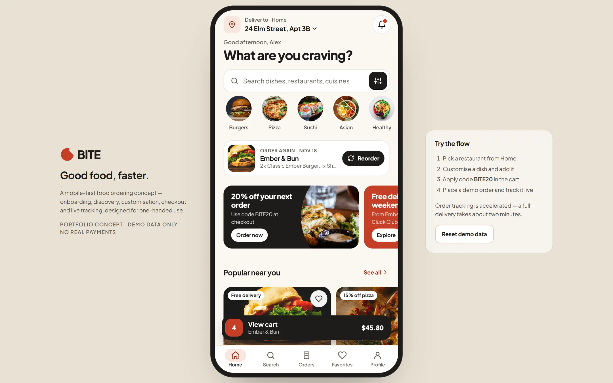
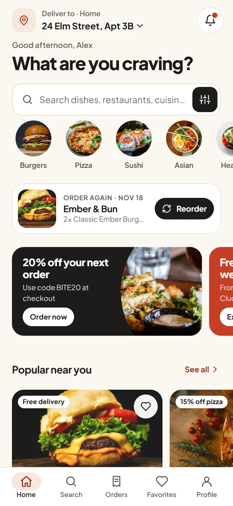
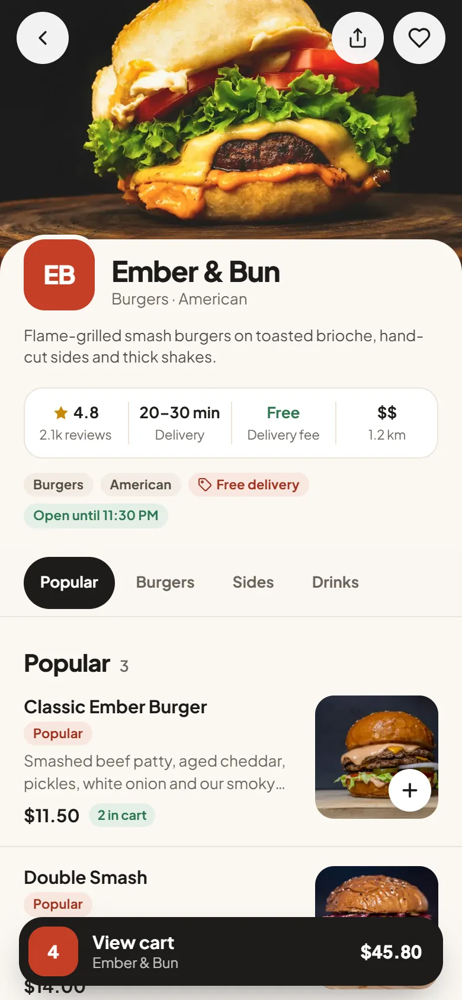
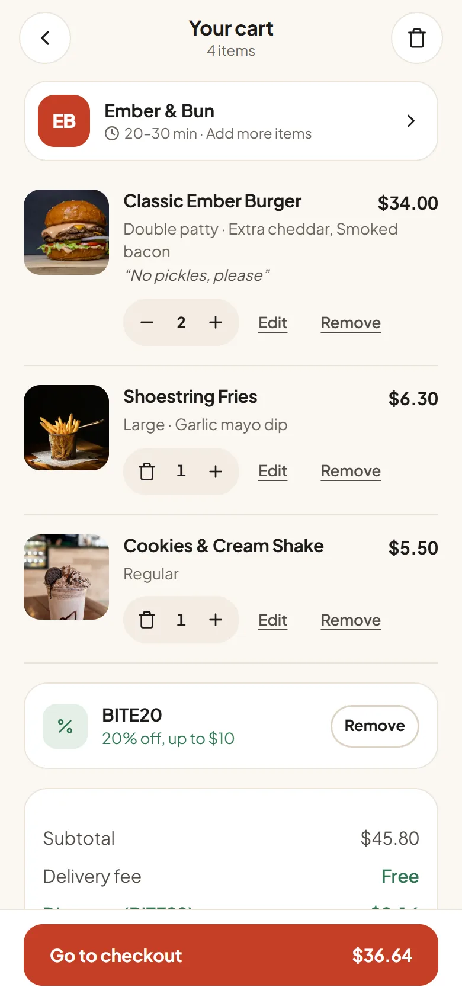
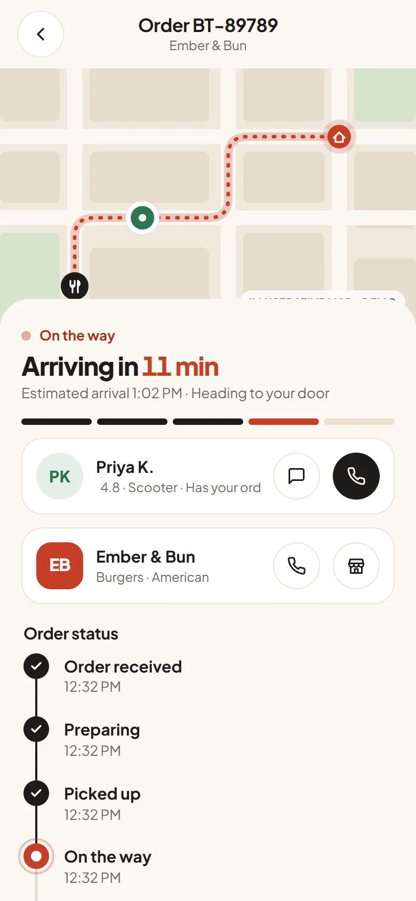

# BITE — Good food, faster.

A mobile-first food ordering app concept, designed and built as an App / Web Designer portfolio piece.
BITE covers the full ordering journey — onboarding, discovery, search, dish customisation, cart, checkout,
confirmation and live order tracking — and is designed to feel like a native mobile app rather than a
website squeezed onto a phone.

> **Demo project.** All restaurants, dishes, prices and people are fictional. There is no backend, no real
> ordering and **no payment processing** — nothing leaves the browser.

**Live demo:** _coming soon — `https://your-demo-url.example`_

---

## Screenshots

<p align="center">
  
</p>

<table>
  <tr>
    <td align="center" width="25%">
      <br>
      <sub><b>Home</b></sub>
    </td>
    <td align="center" width="25%">
      <br>
      <sub><b>Restaurant</b></sub>
    </td>
    <td align="center" width="25%">
      <br>
      <sub><b>Cart</b></sub>
    </td>
    <td align="center" width="25%">
      <br>
      <sub><b>Live tracking</b></sub>
    </td>
  </tr>
</table>

<sub>Mobile captures at 390 × 844 (2×), desktop at 1440 × 900. Running `npm run test:e2e` also saves screenshots of every flow to `tests/shots/`.</sub>

---

## Features

| Area | What's included |
| --- | --- |
| **Onboarding** | 3 swipeable screens (discover · order · track) with photo, floating UI chip, progress dots, Skip / Next / Get started. Completion stored in `localStorage`. |
| **Home** | Time-aware greeting, delivery address switcher (bottom sheet), search entry, photo category rail, live active-order card *or* one-tap reorder shortcut, promo carousel, popular restaurants, popular dishes, recommended list, notification bell with unread dot. |
| **Search** | Live search across restaurant names, dishes, descriptions and categories (accent-insensitive, multi-word). Recent searches (persisted, removable), popular searches, category grid, quick category chips, result tabs (All / Restaurants / Dishes) and an empty state. |
| **Filters** | Bottom sheet with sort (recommended, rating, fastest, nearest), category, minimum rating, delivery time and price level. Active filters appear as removable chips. |
| **Restaurant** | Cover image with collapsing header, monogram logo, rating, ETA, fee, distance, price level, cuisine tags, sticky menu tabs (Popular, Burgers, Pizza, Mains, Sides, Drinks, Desserts) with scroll-spy, dish rows with popular / dietary badges and quick-add. |
| **Food details** | Near-full-height bottom sheet: large image, description, price, kcal, required size/portion options, optional extras, notes (140 chars), quantity stepper and live-priced sticky “Add to cart”. Also used to **edit** cart items. |
| **Cart** | Per-item options, notes, quantity controls (minus becomes delete), edit, remove with **Undo**, promo codes (`BITE20`, `WELCOME5`), subtotal / delivery / discount / total. Persisted in `localStorage`. Adding from another restaurant asks before replacing the cart. |
| **Checkout** | Address (change via sheet) + courier instructions, standard vs scheduled delivery with time slots, validated contact details, Cash / Card / Wallet selection (UI only), full order summary, sticky “Place order” with loading state. |
| **Confirmation** | Animated success state, order number, estimated delivery time, address, payment, total, Track order / Back home. |
| **Tracking** | Illustrated map (no map API) with an animated courier following the route, ETA, 5-step progress, courier and restaurant cards with call/message buttons (demo toasts), timestamped timeline, order details, rating + reorder once delivered. Runs on an accelerated ~2-minute timeline, with a “Skip to next status” control for reviewers. |
| **Orders** | Active / Past tabs. Live progress on active orders; past orders show restaurant, date, total, item summary, status, Details and **Reorder**. |
| **Favorites** | Restaurants and dishes, persisted. Remove (with Undo), add dishes to cart, empty states. |
| **Profile** | Avatar, editable name / email / phone, saved addresses (add new), payment methods, notification settings (switches), language, Help & FAQ, About, and a demo logout that resets all local data. |
| **Notifications** | Order updates, offers and account updates; read/unread states, type filters with unread counts, mark all as read, deep links. Order status changes create notifications + toasts in real time. |

---

## Tech stack

- **Vite 5 + React 18** — no UI framework, no router, no state library
- **Plain CSS** with design tokens (custom properties), per-screen stylesheets that are code-split with their screen
- **Tiny custom hash router** (~80 lines) with push/pop direction for transitions and scroll restoration
- **React Context + `localStorage`** for cart, favorites, orders, notifications, preferences and onboarding state
- **Inline SVG icon set** (paths adapted from Lucide, ISC) — no icon font
- **playwright-core** (dev only) for the end-to-end smoke test, driving an already-installed Chrome / Edge

Runtime dependencies: `react` and `react-dom` only.

---

## Mobile UX decisions

- **Thumb-first layout.** Primary actions live at the bottom: tab bar, floating cart bar, sticky CTAs in sheets, cart and checkout.
- **Bottom sheets instead of new pages** for dish details, filters, address, payment, language, help — context is kept, and sheets can be dragged down, tapped outside or dismissed with Esc.
- **One-tap paths.** Quick-add on every dish, reorder from Home / Orders / delivered tracking, recent searches, category chips.
- **Live pricing.** The Add button always shows the final price for the chosen size, extras and quantity.
- **Safe cart behaviour.** Switching restaurants asks before replacing the cart; removing items and favorites can be undone from the toast.
- **Honest feedback.** Toasts confirm every change; loading state on Place order; validation errors are inline and focus the first invalid field.
- **Horizontal rails** use scroll-snap with a peeking next card so it's obvious there's more.
- **Native feel:** push/pop screen transitions, collapsing restaurant header, sticky menu tabs with scroll-spy, scroll position restored when navigating back, safe-area padding (`viewport-fit=cover`).
- **Restraint:** one accent colour, flat surfaces with hairline borders, shadows only where something floats.

### Visual language

| Token | Value | Use |
| --- | --- | --- |
| Warm off-white | `#FAF7F2` | App background |
| Deep charcoal | `#1E1C1A` | Text, dark buttons, active states |
| Muted tomato | `#C63F27` | Accent, primary CTA (5.2:1 with white text) |
| Soft beige | `#F3ECE2` / `#EADFCF` | Secondary surfaces, placeholders |
| Subtle green | `#2E7650` | Success, free delivery, delivered |

Type: **Plus Jakarta Sans** (Google Fonts), with tight tracking on headings and tabular numerals for prices.

---

## Screens

Onboarding (3) · Home · Search (browse / results / empty) · Filters sheet · Restaurant · Food details sheet ·
Cart (filled / empty) · Checkout · Order confirmation · Order tracking (live / delivered / cancelled) · Orders
(active / past) · Favorites (restaurants / dishes / empty) · Profile (+ edit, payment, notification settings,
language, help, about sheets) · Notifications · Address sheet · Confirm dialogs · 404.

---

## Responsive behaviour

Designed primarily for **390 × 844** and **430 × 932**.

| Viewport | Behaviour |
| --- | --- |
| < 600 px | Full-screen app, edge to edge, respects safe areas. |
| 600 – 1099 px (e.g. 768, 1024) | App centred in a 430 px phone frame on a warm backdrop; height capped at 932 px. |
| ≥ 1100 px (e.g. 1440) | Phone frame centred between a project intro (left) and a “Try the flow” panel with a demo-reset button (right). |

The app is never stretched across a wide viewport — sheets, dialogs and toasts are portalled *inside* the
phone frame so they behave the same at every size.

---

## Accessibility

- Semantic landmarks (`header`, `main`, `nav`, `section`, `article`), one `h1` per screen, ordered headings
- Every icon-only button has an `aria-label`; decorative icons are `aria-hidden`
- Form fields have visible labels, `autocomplete`, `inputmode` and `enterkeyhint`; errors are linked via `aria-describedby` and announced
- Custom controls use native inputs (radio / checkbox) or proper roles: `switch`, `tablist`/`tab`, `radiogroup`, `alertdialog`
- Sheets and dialogs: `aria-modal`, focus moved in, **focus trapped**, Esc closes, focus restored on close, background made `inert`
- Toasts use a polite live region; search result counts and tracking status are announced
- Visible `:focus-visible` ring everywhere; skip link to main content
- Tap targets ≥ 44 px for primary controls (≥ 36 px for compact secondary actions)
- Colour contrast checked against WCAG AA (body text ≥ 5:1 on the background)
- `prefers-reduced-motion` disables transitions and animations

---

## Performance

- **Route-level code splitting**: Home ships in the main chunk; every other screen (JS + CSS) is a 1–4 KB gzip chunk, prefetched when the browser is idle so navigation stays instant.
- Main bundle ≈ **70 KB gzip** (mostly React); total CSS ≈ 7 KB gzip for the shell.
- **Images**: all WebP, cropped with smart attention cropping; list views use 240 px / 560 px `-sm` thumbnails (~10 KB), large variants only in detail views. `loading="lazy"`, `decoding="async"`, explicit dimensions and a warm placeholder with fade-in. Above-the-fold images are eager with `fetchpriority="high"`.
- No heavy dependencies, no icon font, no map SDK.

---

## Demo limitations

- No backend or real API — data lives in `src/data/*.js`, user state in `localStorage`.
- No real payments: Cash / Card / Wallet are UI only and **no card details are ever requested or stored**.
- Order tracking is simulated on an accelerated timeline; the map is an illustration.
- Calls, messages, sharing (falls back to copy link), support chat and language switching are demo-only.
- Promo codes are hard-coded (`BITE20`, `WELCOME5`).
- Photos are stock placeholders that don't depict the fictional restaurants (see [IMAGE_CREDITS.md](IMAGE_CREDITS.md)).

---

## Local setup

Requires Node 18+.

```bash
npm install
npm run dev          # http://localhost:5173
npm run build        # production build to dist/
npm run preview      # serve the build
```

Routing is hash-based and `base` is relative, so `dist/` can be deployed to any static host (GitHub Pages,
Netlify, Vercel) without rewrites.

### End-to-end test

```bash
npm run build
npm run preview -- --port 5199      # terminal 1
npm run test:e2e                    # terminal 2
```

`tests/e2e.mjs` drives every key flow — onboarding, navigation, search, filters, restaurant, dish
customisation, cart (persist, promo, edit, conflict), checkout validation, order placement, tracking,
orders/reorder, favorites, profile, notifications, logout — then checks layout at 390, 430, 768, 1024 and
1440 px. It fails on any console error, overflow or broken step, and saves screenshots to `tests/shots/`.
Set `BROWSER_PATH` if Chrome/Edge isn't found automatically.

### Resetting the demo

Use **Profile → Log out (demo)**, or the **Reset demo data** button on wide screens. Both clear all `bite.*` keys.

---

## Project structure

```
public/images/{restaurants,food,onboarding,banners}/   WebP assets (+ -sm thumbnails)
src/
  data/         restaurants.js · dishes.js · orders.js · notifications.js · user.js
  lib/          router · pricing · orders (status simulation) · format · persistence · modal/focus helpers
  store/        AppStore.jsx — cart, favorites, orders, notifications, prefs, toasts, sheets
  components/   Icon, Img, Logo, Cards, BottomNav, Overlay (Sheet, ConfirmDialog), DishSheet, AddressSheet, MapPlaceholder, Toast, ui
  screens/      one .jsx + .css per screen (lazy-loaded)
  styles/       tokens.css · base.css · components.css
tests/e2e.mjs   end-to-end smoke test
```

---

## Future improvements

- Real backend (menus, auth, orders) and a payment provider in test mode
- Live map with real courier location (e.g. MapLibre + websocket updates)
- Dark mode (tokens are already centralised)
- Real i18n with RTL support for Arabic
- Ratings & reviews, dietary filters, allergen info
- Group orders and split payments
- PWA: offline menu cache, install prompt, push notifications
- Visual regression tests from the existing screenshot run; unit tests for pricing and cart logic

---

## Credits

Photography: Unsplash (Unsplash License) — full list in [IMAGE_CREDITS.md](IMAGE_CREDITS.md).
Icons adapted from Lucide (ISC). Logo and map illustration are original.
